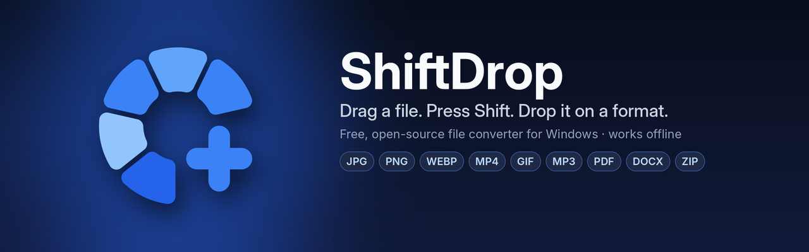
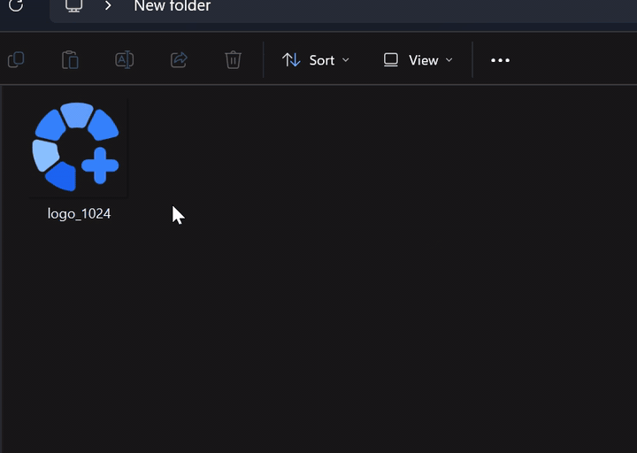
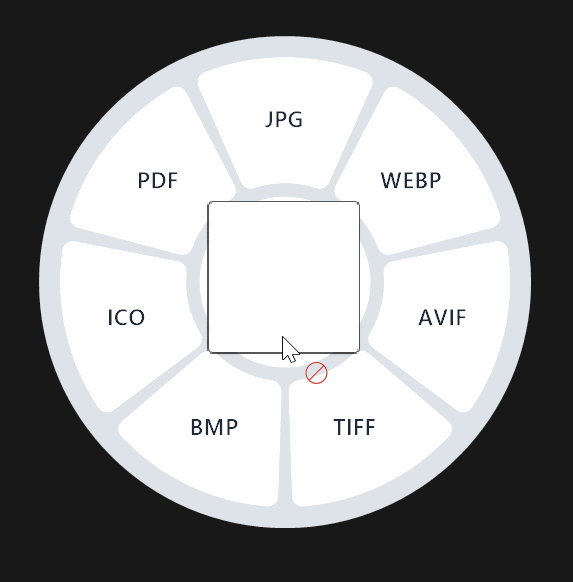
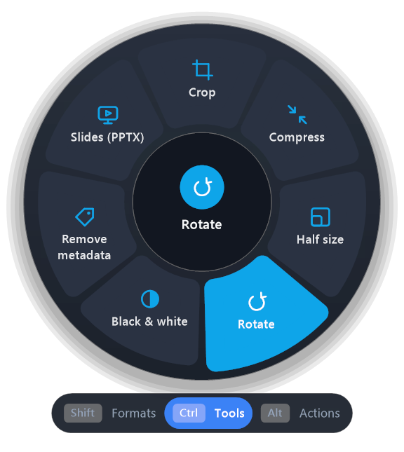
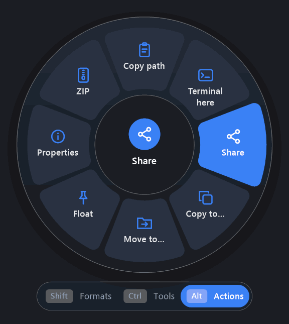
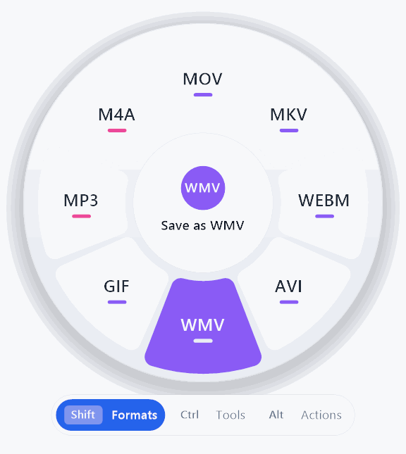
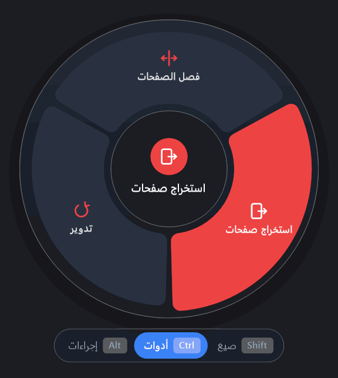
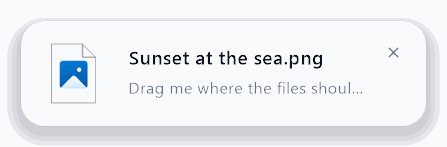

<p align="center">
  
</p>

<p align="center">
  <a href="https://github.com/baraadb/ShiftDrop/releases/latest"></a>
  <a href="https://github.com/baraadb/ShiftDrop/releases"></a>
  
  <a href="LICENSE"></a>
  <a href="https://www.paypal.com/donate/?hosted_button_id=ZNRBHF6SX8ZH6"></a>
</p>

<p align="center">
  <b><a href="https://github.com/baraadb/ShiftDrop/releases/latest">Download</a></b> ·
  <a href="#how-it-works">How it works</a> ·
  <a href="#what-it-converts">Formats</a> ·
  <a href="#faq">FAQ</a> ·
  <a href="#support-shiftdrop">Support</a> ·
  <a href="#arabic">العربية</a>
</p>

<p align="center">
  
</p>

**ShiftDrop turns every drag into a conversion.** Drag a file in File Explorer, press **Shift**, and a wheel of formats opens under your pointer. Drop the file on a format and a converted copy appears next to the original. No windows to open, no upload, no waiting for a website.

It is free, open source, and everything happens **on your PC**.

## Highlights

- **One gesture for everything.** Drag + <kbd>Shift</kbd> for formats, <kbd>Ctrl</kbd> for tools, <kbd>Alt</kbd> for actions.
- **The wheel knows your file.** It only shows what makes sense for what you're holding: image formats for photos, video formats for clips, and so on.
- **Many files at once.** Drag a whole selection; each file gets its own copy, or they are combined when that's the point (merge PDFs, join videos, pictures into one PDF).
- **Images:** convert, crop, compress, resize, rotate, strip location and camera data.
- **Video and audio:** convert, trim on a timeline (waveform and frames), crop the picture, split, compress, mute, speed up, slow down, grab a frame, make a GIF, extract the sound, mono/stereo with levels.
- **PDF and documents:** PDF to pictures, text, Word, Excel, PowerPoint or EPUB; merge, split, extract pages; Word, RTF, HTML, Markdown and text to PDF or EPUB with proper Arabic.
- **Spreadsheets without Office:** XLSX, ODS, CSV and TSV into each other, and to a clean PDF table.
- **Share in one move.** Drop on *Share* to open the Windows share sheet (Nearby sharing, Mail, Teams, WhatsApp…), or on *Float* to keep the files in a little card on top of everything until you drag them somewhere.
- **Safe by design.** Your original is never touched, nothing is ever overwritten, and a cancelled or failed job leaves nothing behind.
- **Private.** No account, no telemetry, no upload. It works without internet. ([Privacy policy](PRIVACY.md))
- **Light and fast.** Native Win32 and GDI+, no Electron. English and Arabic, light and dark.

## Screenshots

<table>
  <tr>
    <td align="center"><br><sub><b>Shift</b> · formats for a picture</sub></td>
    <td align="center"><br><sub><b>Ctrl</b> · tools (dark)</sub></td>
    <td align="center"><br><sub><b>Alt</b> · actions for any file</sub></td>
  </tr>
  <tr>
    <td align="center"><br><sub>A video, hovering WMV</sub></td>
    <td align="center"><br><sub>PDF tools, in Arabic</sub></td>
    <td align="center"><br><sub><b>Float</b> · files on top, ready to drag</sub></td>
  </tr>
</table>

## Download

1. Get **`ShiftDrop-Setup-<version>.exe`** from the [latest release](https://github.com/baraadb/ShiftDrop/releases/latest).
2. Run it. It installs for your account only: no administrator rights, nothing else to download.
3. ShiftDrop starts and sits in the tray next to the clock. That's it.

The installer contains everything (the app, the .NET runtime, FFmpeg and PDFium), so it also works on a PC without internet. ShiftDrop checks GitHub for updates once a day and installs them with one click; you can turn that off in Settings.

See the [code signing policy](#code-signing-policy).

> **Windows SmartScreen** may say *"Windows protected your PC"* because the installer is new and not code-signed. Click **More info → Run anyway**. The full source and the build that produced the installer are public in this repository.

## How it works

| Do this | You get |
| --- | --- |
| Drag a file, then press <kbd>Shift</kbd> | The **formats** wheel for that file |
| While the wheel is open, press <kbd>Ctrl</kbd> | **Tools**: crop, compress, trim, rotate, merge… |
| While the wheel is open, press <kbd>Alt</kbd> | **Actions**: copy path, terminal here, share, copy to, move to, properties, ZIP |
| Drop on a slot | It runs; a progress card shows in the corner and the new file lands next to the original |
| Drop in the middle or outside the wheel | Nothing happens |
| Right-click a file → **Send to** → **ShiftDrop** | The wheel without dragging: click a slot, or use the arrows and <kbd>Enter</kbd>, <kbd>Tab</kbd> to switch wheels |

Once the wheel is open you can let go of the keys. The keys themselves can be changed in Settings.

**Crop** (pictures and videos) opens a small editor: drag the frame or its corners, pick a ratio (Free, 1:1, 4:3, 3:2, 16:9, 9:16), press <kbd>Enter</kbd>. **Trim** shows the waveform (and frames for videos): drag the two ends, play the selection, or cut the quiet ends automatically.

## What it converts

| Files | Convert to | Tools |
| --- | --- | --- |
| **Images** — JPG, PNG, WebP, HEIC, AVIF, TIFF, BMP, ICO, SVG | JPG, PNG, WebP, AVIF, TIFF, BMP, ICO, PDF | Crop, compress, half size, rotate, black & white, remove metadata, many pictures → one PDF, pictures → slides (PPTX) |
| **GIF** | MP4, MOV, WebM, PNG, JPG, WebP | |
| **Video** — MP4, MOV, MKV, WebM, AVI, WMV… | MP4, MOV, MKV, WebM, AVI, WMV, GIF, MP3, M4A | Compress, trim, crop, split, remove sound, speed ×2, slow ×½, rotate, snapshot, remove metadata, join |
| **Audio** — MP3, M4A, WAV, FLAC, OGG, Opus, AIFF, WMA | any of these | Compress, trim, split, normalize, channels (mono / stereo, levels), remove metadata |
| **PDF** | JPG, PNG (300 DPI), TXT, DOCX, XLSX, PPTX, EPUB, MD, HTML | Merge, split pages, extract pages, rotate |
| **Documents** — DOCX, RTF, HTML, EPUB, MD, TXT | PDF, DOCX, EPUB, MD, HTML, TXT | |
| **Spreadsheets** — XLSX, ODS, CSV, TSV | XLSX, ODS, CSV, TSV, PDF, HTML | |
| **Subtitles** — SRT, VTT | SRT, VTT, TXT | Shift timing |
| **Archives** — ZIP, TAR, TAR.GZ, GZ (7z and RAR with 7-Zip installed) | ZIP, TAR, TAR.GZ | Extract |
| **Anything** (files and folders) | | Copy path, terminal here, share, copy to, move to, float, properties, ZIP |

Documents and spreadsheets become PDF through Windows' own *Microsoft Print to PDF*, so text stays real, selectable text (Arabic included). Microsoft Office is not needed. PDF → Excel rebuilds tables from where the text sits on the page: great for invoices and statements made by programs; scanned pages have no text to read.

## Settings

Click the ShiftDrop icon next to the clock (or right-click it → **Settings…**):

- Start with Windows, pause for a while, language (English / Arabic / same as Windows), light or dark look
- Which key opens the wheel, its size, key hints, and whether it works in every app or only in File Explorer
- Where results go: next to the original, the Downloads folder, or a folder you choose
- Progress cards, opening the folder when a job is done
- Automatic updates, the log folder, licences

## Privacy and safety

- Files never leave your PC. ShiftDrop only goes online to check GitHub for a newer version, and you can switch that off.
- The original file is opened read-only. Results are written to a hidden staging folder first and only then moved into place, under a free name (`photo 2.jpg` instead of overwriting `photo.jpg`).
- Cancel any job from its card; nothing half-written is left behind.

## FAQ

<details>
<summary><b>The wheel doesn't open.</b></summary>

Make sure ShiftDrop is running (its icon is next to the clock) and not paused. By default the wheel works while dragging in File Explorer and on the desktop; turn on *Work in all apps* in Settings for other places. If Explorer runs as administrator, ShiftDrop (which doesn't) can't receive its drops.
</details>

<details>
<summary><b>Where is the converted file?</b></summary>

Next to the original, unless you chose the Downloads folder or another folder in Settings. Click <i>Show in folder</i> on the card to jump to it.
</details>

<details>
<summary><b>Does it need internet, an account, or Office?</b></summary>

No. Everything it needs is inside the installer.
</details>

<details>
<summary><b>How do I uninstall it?</b></summary>

Windows Settings → Apps → Installed apps → ShiftDrop → Uninstall.
</details>

<details>
<summary><b>Is it really free?</b></summary>

Yes, and open source under the MIT licence. If ShiftDrop saves you time, you can <a href="https://www.paypal.com/donate/?hosted_button_id=ZNRBHF6SX8ZH6">support its development</a>. It's completely optional.
</details>

## Support ShiftDrop

ShiftDrop is free and always will be. If it makes your day a little easier, a small donation keeps it growing: new formats, new tools, and the time to polish them.

<p>
  <a href="https://www.paypal.com/donate/?hosted_button_id=ZNRBHF6SX8ZH6"></a>
</p>

Starring the repository, reporting bugs and suggesting formats help just as much.

## Build from source

You need Windows 10/11 and nothing else; the script fetches the .NET 10 SDK, ShiftDrop's FFmpeg and resvg, and PDFium by itself.

```text
Install.cmd          build and install for the current user
Build-Setup.cmd      build the single-file installer: build\ShiftDrop-Setup-<version>.exe
```

For development:

```text
dotnet build src/ShiftDrop                        # the Windows app
dotnet run --project tests/ShiftDrop.Tests         # engine tests (SHIFTDROP_FFMPEG_DIR, _PDFIUM_DIR, _RESVG_DIR)
dotnet build src/ShiftDrop -p:AppTfm=net10.0       # compile check on Linux or macOS
```

| Folder | What's inside |
| --- | --- |
| `src/ShiftDrop.Core` | Cross-platform engines: the format catalogue, a job queue with atomic output, FFmpeg, PDFium, documents, subtitles, archives |
| `src/ShiftDrop` | The Windows app in plain Win32: mouse hook, OLE drop-target wheel drawn with GDI+, tray, progress cards, crop editor, share sheet, settings |
| `tests/ShiftDrop.Tests` | End-to-end tests that make their own sample files |
| `installer` | Build-and-install script, Inno Setup script, uninstaller |
| `tools/ffmpeg` | ShiftDrop's own FFmpeg: the build script, pinned versions, and the speed comparison |

Every push to `main` is built and tested on Windows by GitHub Actions; a new version number publishes a release with the installer.

**ShiftDrop's FFmpeg.** ShiftDrop ships its own FFmpeg build, made by [`tools/ffmpeg/build.sh`](tools/ffmpeg/build.sh): every built-in FFmpeg format, plus only the outside libraries ShiftDrop uses (dav1d, libaom, SVT-AV1, libvpx, libwebp, Opus, Vorbis, LAME, and the NVIDIA, AMD, Intel and Media Foundation encoders), compiled with GCC 16 into shared DLLs. It is about a quarter of the size of a full build. Before a build is published, the [tools workflow](.github/workflows/tools.yml) runs every test with it on Windows and times it against the previous FFmpeg on the same machine; a slower build is not published. Once a month it is rebuilt with FFmpeg's newest code.

## Code signing policy

Windows releases will be signed through free code signing provided by [SignPath.io](https://about.signpath.io), certificate by [SignPath Foundation](https://signpath.org). *(Application in progress; until it is approved the installer is unsigned.)*

- Only files built by GitHub Actions from this repository's source are signed. Each signing request is approved by hand.
- **Team:** [@baraadb](https://github.com/baraadb) is the author, reviewer and approver. Changes from other people are reviewed before they are merged.
- **Privacy:** ShiftDrop doesn't collect or send any personal data. See the [privacy policy](PRIVACY.md).

The Microsoft Store version is signed by Microsoft.

## Credits

ShiftDrop stands on great open-source work: [FFmpeg](https://ffmpeg.org) and the codec libraries inside it, [resvg](https://github.com/linebender/resvg), [PDFium](https://pdfium.googlesource.com/pdfium), and [.NET](https://dotnet.microsoft.com). The FFmpeg toolchain image comes from [BtbN/FFmpeg-Builds](https://github.com/BtbN/FFmpeg-Builds). Details in [THIRD_PARTY_NOTICES.md](THIRD_PARTY_NOTICES.md).

ShiftDrop is an independent project inspired by the drag-to-convert idea of Tangerine for Mac. It shares no code, name or assets with it.

Licence: [MIT](LICENSE).

---

<a id="arabic"></a>

<div dir="rtl">

<h1 align="center">ShiftDrop بالعربي</h1>

<p align="center">
  <b><a href="https://github.com/baraadb/ShiftDrop/releases/latest">تنزيل البرنامج</a></b> ·
  <a href="https://www.paypal.com/donate/?hosted_button_id=ZNRBHF6SX8ZH6">ادعم المطوّر</a>
</p>

**حوّل أي ملف وأنت تسحبه.** اسحب ملفًا في مستكشف الملفات واضغط <kbd>Shift</kbd>، فتظهر تحت المؤشر عجلة فيها الصيغ المناسبة لملفك. أفلت الملف على الصيغة، فتنحفظ نسخة جديدة بجانب الأصل. بلا نوافذ، وبلا رفع على مواقع، وبلا انتظار.

البرنامج مجاني ومفتوح المصدر، وكل شيء يعمل **على جهازك**.

## المميزات

- **حركة واحدة لكل شيء:** سحب مع <kbd>Shift</kbd> للصيغ، و<kbd>Ctrl</kbd> للأدوات، و<kbd>Alt</kbd> للإجراءات.
- **العجلة تعرف ملفك:** تعرض فقط ما يناسبه؛ صيغ صور للصور، وصيغ فيديو للفيديو، وهكذا.
- **عدة ملفات مرة واحدة:** كل ملف يأخذ نسخته، أو تُدمج معًا حين يكون هذا هو المطلوب (دمج PDF، دمج فيديو، عدة صور في PDF واحد).
- **الصور:** تحويل، **قص الصورة**، ضغط، تصغير، تدوير، وحذف بيانات الموقع والكاميرا.
- **الفيديو والصوت:** تحويل، قص المدة على شريط زمني (موجة الصوت وإطارات الفيديو)، قص إطار الفيديو، تقسيم لأجزاء، ضغط، حذف الصوت، تسريع، إبطاء، لقطة من الفيديو، تحويل إلى GIF، استخراج الصوت، وأحادي أو ستيريو مع مستوى كل جهة.
- **PDF والمستندات:** من PDF إلى صور أو نص أو Word أو Excel أو PowerPoint أو EPUB، مع الدمج والفصل واستخراج الصفحات؛ ومن Word وRTF وHTML وMarkdown والنص إلى PDF أو EPUB بعربية سليمة.
- **جداول بدون Office:** بين XLSX وODS وCSV وTSV، وإلى PDF بجدول مرتب.
- **مشاركة بحركة واحدة:** أفلت الملف على «مشاركة» لتفتح نافذة المشاركة في Windows (المشاركة القريبة، البريد، Teams، واتساب...)، أو على «إبقاء عائمًا» ليبقى الملف في بطاقة صغيرة فوق كل النوافذ حتى تسحبه لأي مكان.
- **آمن:** الملف الأصلي لا يُمس، ولا يُكتب فوق أي ملف، والعملية الملغاة أو الفاشلة لا تترك أي بقايا.
- **خصوصية كاملة:** بلا حساب، وبلا تتبّع، وبلا رفع. يعمل بدون إنترنت.
- **خفيف وسريع:** مكتوب بواجهات Windows الأصلية، بالعربية والإنجليزية، وبمظهر فاتح وداكن.

## التنزيل والتثبيت

1. نزّل الملف **`ShiftDrop-Setup-<الإصدار>.exe`** من [آخر إصدار](https://github.com/baraadb/ShiftDrop/releases/latest).
2. شغّله. يُثبَّت لحسابك فقط، بلا صلاحيات مدير، وبلا أي تنزيلات إضافية.
3. يعمل البرنامج ويظهر بجانب الساعة. انتهى.

ملف التثبيت فيه كل شيء، فيعمل حتى على جهاز بلا إنترنت. يبحث البرنامج عن تحديثات مرة في اليوم ويثبّتها بنقرة، ويمكنك إيقاف ذلك من الإعدادات.

> قد تظهر رسالة **Windows SmartScreen** «Windows protected your PC» لأن ملف التثبيت جديد وغير موقّع رقميًا. اضغط **More info** ثم **Run anyway**. الكود المصدري كاملًا موجود هنا، وملف التثبيت مبني منه آليًا.

## طريقة الاستخدام

| الحركة | النتيجة |
| --- | --- |
| اسحب ملفًا ثم اضغط <kbd>Shift</kbd> | عجلة **الصيغ** المناسبة للملف |
| والعجلة مفتوحة اضغط <kbd>Ctrl</kbd> | عجلة **الأدوات**: قص، ضغط، تدوير، دمج... |
| والعجلة مفتوحة اضغط <kbd>Alt</kbd> | عجلة **الإجراءات**: نسخ المسار، الطرفية هنا، مشاركة، نسخ إلى، نقل إلى، الخصائص، ZIP |
| أفلت على خانة | تبدأ العملية، وتظهر بطاقة تقدّم في الزاوية، والملف الجديد بجانب الأصل |
| أفلت في المنتصف أو خارج العجلة | إلغاء |
| زر يمين على ملف ← «إرسال إلى» ← ShiftDrop | العجلة بلا سحب: انقر على خانة، أو استخدم الأسهم وEnter، وTab للتبديل |

بعد ما تفتح العجلة تقدر تترك الأزرار، وتقدر تغيّر الأزرار نفسها من الإعدادات.

**قص الصورة والفيديو** يفتح محررًا صغيرًا: اسحب الإطار أو زواياه، واختر النسبة (حر، 1:1، 4:3، 3:2، 16:9، 9:16)، ثم اضغط Enter. و**قص المدة** يعرض موجة الصوت (وإطارات الفيديو): اسحب الطرفين، وشغّل الجزء المحدد، أو اقطع الصمت من الأطراف تلقائيًا.

## الصيغ المدعومة

| الملفات | التحويل إلى | الأدوات |
| --- | --- | --- |
| **صور**: JPG وPNG وWebP وHEIC وAVIF وTIFF وBMP وICO وSVG | JPG، PNG، WebP، AVIF، TIFF، BMP، ICO، PDF | قص، ضغط، نصف الحجم، تدوير، أبيض وأسود، حذف البيانات، عدة صور في PDF واحد، عرض شرائح PPTX |
| **GIF** | MP4، MOV، WebM، PNG، JPG، WebP | |
| **فيديو**: MP4 وMOV وMKV وWebM وAVI وWMV... | MP4، MOV، MKV، WebM، AVI، WMV، GIF، MP3، M4A | ضغط، قص المدة، قص الإطار، تقسيم، حذف الصوت، سرعة ×2، بطء ×½، تدوير، لقطة، حذف البيانات، دمج |
| **صوت**: MP3 وM4A وWAV وFLAC وOGG وOpus وAIFF وWMA | أي صيغة منها | ضغط، قص، تقسيم، توحيد الصوت، القنوات (أحادي أو ستيريو مع المستوى)، حذف البيانات |
| **PDF** | JPG، PNG بدقة 300، TXT، DOCX، XLSX، PPTX، EPUB، MD، HTML | دمج، فصل الصفحات، استخراج صفحات، تدوير |
| **مستندات**: DOCX وRTF وHTML وEPUB وMD وTXT | PDF، DOCX، EPUB، MD، HTML، TXT | |
| **جداول**: XLSX وODS وCSV وTSV | XLSX، ODS، CSV، TSV، PDF، HTML | |
| **ترجمات**: SRT وVTT | SRT، VTT، TXT | إزاحة التوقيت |
| **أرشيف**: ZIP وTAR وTAR.GZ وGZ (و7z وRAR مع 7-Zip) | ZIP، TAR، TAR.GZ | استخراج |
| **أي ملف أو مجلد** | | نسخ المسار، الطرفية هنا، مشاركة، نسخ إلى، نقل إلى، إبقاء عائمًا، الخصائص، ZIP |

تحويل المستندات والجداول إلى PDF يتم عبر طابعة Microsoft Print to PDF المدمجة في Windows، فيبقى النص العربي صحيحًا وقابلًا للتحديد. لا يحتاج Office. وتحويل PDF إلى Excel يعيد بناء الجداول من أماكن النص في الصفحة: ممتاز للفواتير والكشوفات، أما الصفحات الممسوحة ضوئيًا فلا نص فيها ليُقرأ.

## الإعدادات

انقر على أيقونة ShiftDrop بجانب الساعة (أو زر يمين عليها ثم «الإعدادات»):

- التشغيل مع Windows، الإيقاف المؤقت، اللغة، والمظهر الفاتح أو الداكن
- الزر الذي يفتح العجلة، وحجمها، وتلميحات الأزرار، والعمل في كل التطبيقات أو في المستكشف فقط
- مكان الحفظ: بجانب الأصل، أو مجلد التنزيلات، أو مجلد تختاره
- بطاقات التقدّم، وفتح المجلد بعد انتهاء العملية
- التحديثات التلقائية، ومجلد السجلات، والتراخيص

## الخصوصية والأمان

- ملفاتك لا تغادر جهازك. البرنامج يتصل بالإنترنت فقط ليبحث عن إصدار جديد على GitHub، ويمكنك إيقاف ذلك.
- الملف الأصلي يُفتح للقراءة فقط، والنتيجة تُكتب أولًا في مجلد مخفي مؤقت ثم تُنقل باسم غير مستخدم (مثل `photo 2.jpg` بدل الكتابة فوق `photo.jpg`).
- تقدر تلغي أي عملية من بطاقتها، ولا يبقى أي ملف ناقص.

## أسئلة شائعة

<details>
<summary><b>العجلة لا تظهر.</b></summary>

تأكد أن البرنامج يعمل (أيقونته بجانب الساعة) وأنه غير موقوف مؤقتًا. العجلة تعمل افتراضيًا أثناء السحب في المستكشف وسطح المكتب، وفعّل «العمل في كل التطبيقات» من الإعدادات لباقي الأماكن. وإذا كان المستكشف يعمل كمسؤول، فلن يستقبل ShiftDrop الملفات منه.
</details>

<details>
<summary><b>أين الملف الناتج؟</b></summary>

بجانب الملف الأصلي، إلا إذا اخترت مجلد التنزيلات أو مجلدًا آخر من الإعدادات. اضغط «عرض في المجلد» على البطاقة للوصول إليه.
</details>

<details>
<summary><b>هل يحتاج إنترنت أو حسابًا أو Office؟</b></summary>

لا. كل ما يحتاجه موجود داخل ملف التثبيت.
</details>

<details>
<summary><b>كيف أحذف البرنامج؟</b></summary>

من إعدادات Windows ← التطبيقات ← التطبيقات المثبتة ← ShiftDrop ← إلغاء التثبيت.
</details>

<details>
<summary><b>هل هو مجاني فعلًا؟</b></summary>

نعم، ومفتوح المصدر بترخيص MIT. وإذا وفّر عليك وقتًا، تقدر <a href="https://www.paypal.com/donate/?hosted_button_id=ZNRBHF6SX8ZH6">تدعم تطويره</a>، والدعم اختياري تمامًا.
</details>

## ادعم ShiftDrop

البرنامج مجاني وسيبقى مجانيًا. إذا سهّل عليك شغلك، فالتبرع البسيط يساعد على استمراره: صيغ جديدة، وأدوات جديدة، ووقت لتحسينها.

<p>
  <a href="https://www.paypal.com/donate/?hosted_button_id=ZNRBHF6SX8ZH6"></a>
</p>

وإضافة نجمة للمستودع، والإبلاغ عن الأخطاء، واقتراح صيغ جديدة، كلها دعم لا يقل أهمية.

## الترخيص

مفتوح المصدر بترخيص [MIT](LICENSE). المكونات الخارجية وتراخيصها في [THIRD_PARTY_NOTICES.md](THIRD_PARTY_NOTICES.md).

</div>
